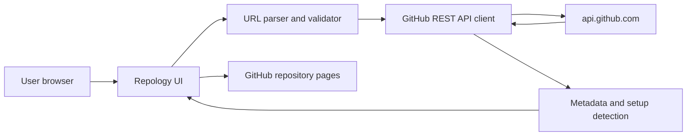

# Repology — Architecture and API Plan

## 1. Architecture decision

Ship a static single-page application using **Vite + vanilla JavaScript modules + CSS**. The browser calls GitHub's public REST API directly. No server, database, account, AI service, worker, or repository execution is needed for v1.

This minimizes the surface area, deployment time, operational cost, and secrets handling. It also means API requests are unauthenticated and subject to GitHub's rate limits for the user's network IP.

## 2. System context



## 3. Recommended source layout

```text
src/
  main.js                    # App entry and top-level event wiring
  styles/
    tokens.css               # CSS variables and theme tokens
    global.css               # Reset, typography, focus, layout
    components.css           # Cards, buttons, pills, tabs, states
  core/
    parse-repo-url.js        # Pure owner/repo parser and validator
    detect-project.js        # File-name and manifest signal detection
    setup-guides.js          # Evidence-labelled setup suggestions
    formatters.js            # Counts, dates, nullable field handling
  services/
    github-api.js            # Fetch wrapper, errors, in-memory cache
    repository-service.js    # Orchestrates minimal repository requests
  ui/
    render-landing.js
    render-results.js
    render-readme.js         # Sanitized Markdown or escaped text
    render-files.js
    render-setup.js
    render-contribute.js
    render-states.js
  test/
    parse-repo-url.test.js
    detect-project.test.js
    setup-guides.test.js
index.html
```

Do not over-abstract a small MVP. These names are a suggested organization; consolidate files if splitting them slows delivery, but keep URL parsing and detection logic testable and separate from DOM rendering.

## 4. Data flow

1. Normalize the user input into `{ owner, repo }`.
2. Reject invalid hosts, paths, empty segments, whitespace-only input, URL fragments, and unsupported routes before network access.
3. Call `GET /repos/{owner}/{repo}`.
4. If metadata is available, call `GET /repos/{owner}/{repo}/readme` and `GET /repos/{owner}/{repo}/contents?ref={default_branch}` in a controlled sequence.
5. Render metadata immediately when possible, then fill README and file sections independently. If a non-critical request fails, retain the sections that succeeded.
6. Only when the Setup panel is opened, fetch the exact manifest files that were detected in the root listing, such as `package.json` or `requirements.txt`.
7. Derive setup suggestions from manifest contents and visible signals. Link all source files on GitHub.
8. The user follows a link to GitHub or copies a suggested command; Repology never executes it.

## 5. GitHub API requests

Use `Accept: application/vnd.github+json` and a documented API version header supported by the implementation. Confirm the current recommended API version during implementation from GitHub's official docs.

| Purpose | Endpoint | When |
|---|---|---|
| Repository metadata | `GET /repos/{owner}/{repo}` | Every valid analysis |
| README | `GET /repos/{owner}/{repo}/readme` | Initial overview; independent fallback |
| Root listing | `GET /repos/{owner}/{repo}/contents?ref={default_branch}` | Initial overview |
| Manifest detail | `GET /repos/{owner}/{repo}/contents/{path}?ref={default_branch}` | On-demand when Setup opens |
| Expanded directory | `GET /repos/{owner}/{repo}/contents/{path}?ref={default_branch}` | P1 only, when a folder expands |

Avoid the GitHub search API in the MVP. It has separate rate-limit behavior and is unnecessary to orient the user in a known repository. Link directly to `https://github.com/{owner}/{repo}/issues`, `/pulls`, and detected files instead of querying them.

### Rate-limit behavior

GitHub documents a primary unauthenticated REST limit of 60 requests per hour per originating IP. A school, campus, office, or mobile carrier network may share the same public IP across many users, so the product can be rate-limited even if one user has made few requests.

- Make only the calls needed for the current view.
- Cache successful GET responses in memory for the current tab/session.
- Deduplicate requests to the same endpoint while a request is already in flight.
- Avoid polling and automatic repeated retries.
- On HTTP 403/429, inspect `x-ratelimit-remaining`, `x-ratelimit-reset`, and `retry-after` when present; do not retry in a tight loop.
- Explain that the limit is temporary and is imposed by GitHub, not a user-input error.
- Do not hide the failure or show fabricated cached-looking results as current data. If showing an in-memory cached result after a refresh fails, label it as cached.

## 6. API client contract

`github-api.js` should export a single typed-by-convention wrapper around `fetch`:

- Inputs: endpoint path from internal builders only; optional request options.
- Outputs: parsed JSON or raw text for README, plus response metadata needed to show rate-limit state.
- Errors: normalized objects with `kind` (`not-found`, `rate-limit`, `network`, `forbidden`, `invalid-response`, `unknown`), status, and retry guidance if available.
- Safety: construct API URLs from validated owner/repo/path segments; never pass arbitrary user URLs to `fetch`.
- Caching: map of normalized request URL to in-flight promise/result with bounded size for the session. A simple 20-entry FIFO cache is enough; do not build a caching framework.
- Cancellation: abort stale requests when the user switches to a different repository, if this can be added without complicating the MVP.

## 7. URL parsing rules

Accept:

- `owner/repo`
- `https://github.com/owner/repo`
- `https://github.com/owner/repo/`
- `https://github.com/owner/repo.git`

Reject:

- Any non-GitHub hostname, including look-alike hosts such as `github.com.example.org`.
- Missing owner or repository.
- GitHub profile URLs with only one path segment.
- Arbitrary query/fragment strings if they create ambiguity.
- Extra route segments unless the implementation deliberately strips a recognized `/tree/{branch}` or `/blob/{branch}/...` path and explains that it will analyze the repository root. Simplest MVP behavior: reject or clearly normalize those paths rather than silently misinterpret them.

The URL parser must be a pure function with unit tests and must not make network requests.

## 8. Project detection

### Initial signals from root filenames

| Signal | Files | What the UI may say |
|---|---|---|
| Node / JavaScript / TypeScript | `package.json`, `package-lock.json`, `pnpm-lock.yaml`, `yarn.lock`, `bun.lock`, `bun.lockb`, `tsconfig.json` | “Node ecosystem files detected”; identify lockfile/package manager if unambiguous |
| Python | `pyproject.toml`, `requirements.txt`, `Pipfile`, `poetry.lock`, `uv.lock` | “Python packaging files detected”; identify exact manifest(s) |
| Go | `go.mod`, `go.sum` | “Go module detected” |
| Rust | `Cargo.toml`, `Cargo.lock` | “Rust manifest detected” |
| Java / JVM | `pom.xml`, `build.gradle`, `build.gradle.kts`, `gradlew` | “JVM build files detected” |
| .NET | `*.sln`, `*.csproj`, `global.json` | “.NET project files detected” |
| Containers | `Dockerfile`, `compose.yaml`, `docker-compose.yml` | “Container configuration detected” |
| Documentation | `README*`, `CONTRIBUTING*`, `docs/` | Link to docs/contribution guide when present |

The repository metadata's `language` field is the **primary language reported by GitHub**, not a complete list or guaranteed framework identification. Label it accordingly.

## 9. README rendering and output safety

Option A (best visual result): render Markdown with a maintained Markdown parser such as `marked`, then sanitize the HTML with `DOMPurify` before inserting into the DOM. Do not allow arbitrary embedded scripts, unsafe URLs, forms, iframes, or event handlers. Test a malicious fixture.

Option B (best for the tightest launch): show escaped plain text/preformatted README excerpt and link to the canonical README on GitHub. This is safer and simpler, but less polished.

Do not insert raw README HTML into `innerHTML`. For repository names, descriptions, paths, issues, and manifest values, prefer `textContent` and DOM creation APIs. External links should use HTTPS URLs assembled from validated hostnames and `target="_blank" rel="noopener noreferrer"` when opening a new tab.

## 10. Setup guide contract

Each setup card should contain:

- **Signal found:** exact root file/manifest.
- **Command:** only if a documented or detected command is available.
- **Evidence label:** Detected / Suggested / Not verified.
- **Source link:** link to the file or README section on GitHub.
- **Caveat:** Repology does not install dependencies or run the command.

For `package.json`, parse only the JSON content and list scripts actually present. Do not assume a `dev`, `start`, or `test` script exists. If multiple lockfiles disagree, state that ambiguity instead of selecting a package manager silently.

## 11. State model

Top-level states:

- `idle`
- `validating`
- `loading-metadata`
- `loading-details`
- `success`
- `partial-success`
- `not-found-or-private`
- `rate-limited`
- `network-error`
- `invalid-input`

The UI should not freeze while waiting. Each result section may also have its own `loading`, `loaded`, `missing`, or `failed` state. Keep the number of states small and visible.

## 12. Deployment

- Build command: `npm run build`.
- Static output: Vite's `dist/` directory.
- Vercel should detect the Vite project; verify the build command and output directory from the dashboard or project settings.
- Do not add environment variables for the public unauthenticated REST API.
- Test the exact production URL in a private/incognito session and on mobile before sharing it.
- Keep a rollback option: the previous deploy remains available in the hosting dashboard; do not delete a working deploy until the new one passes smoke tests.

## 13. References

- Repository content and README endpoint: https://docs.github.com/en/rest/repos/contents
- REST API rate limits: https://docs.github.com/en/rest/using-the-rest-api/rate-limits-for-the-rest-api
- REST API best practices: https://docs.github.com/en/rest/using-the-rest-api/best-practices-for-using-the-rest-api
- Vite on Vercel: https://vercel.com/docs/frameworks/frontend/vite
